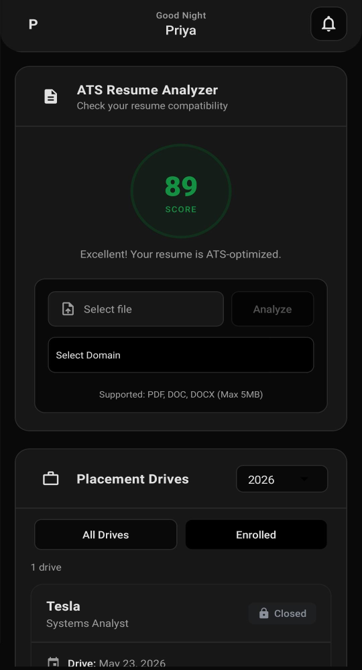
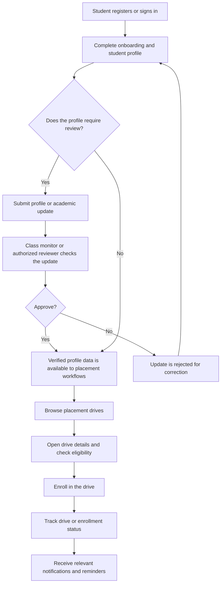
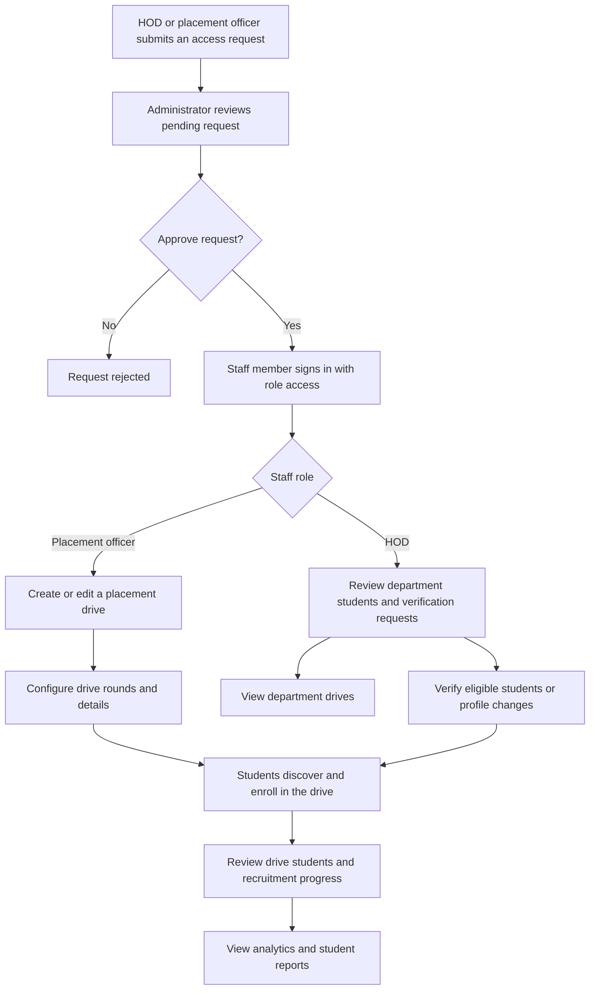
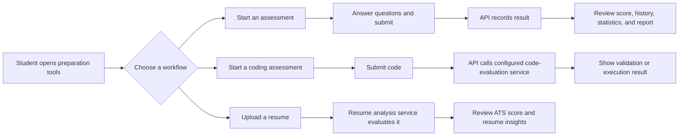
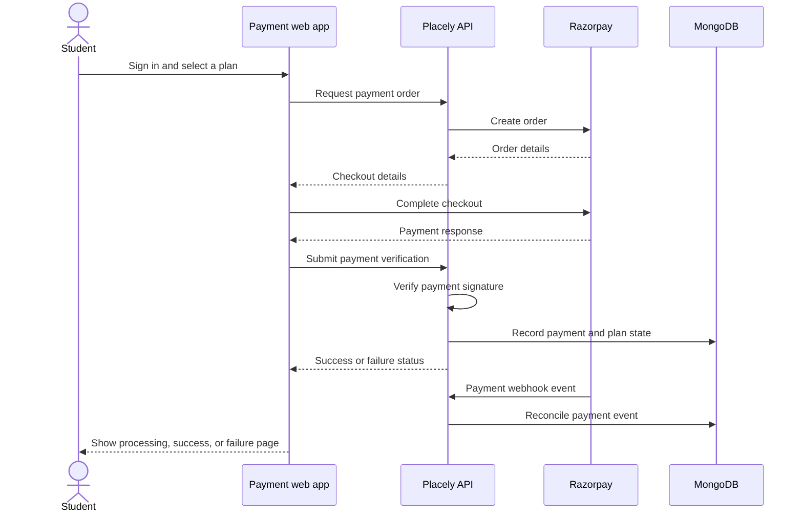
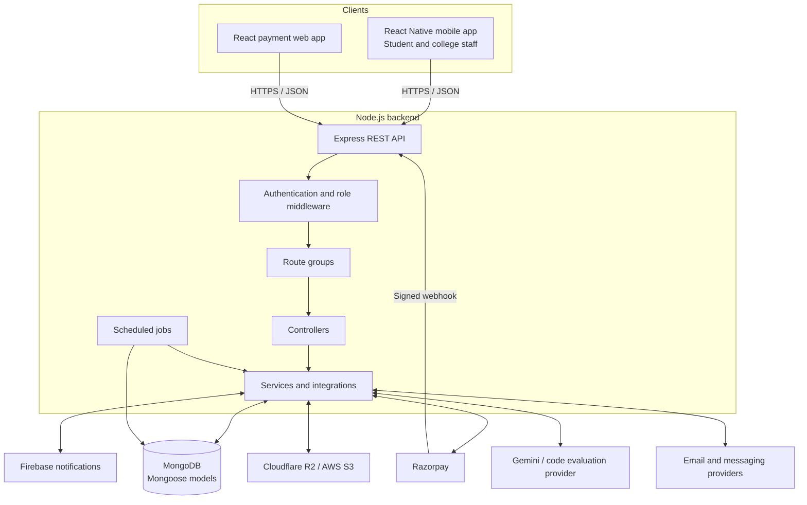

# Placely — College Placement Management Platform

> **One platform for students preparing for placements and the college teams coordinating them.**
>
> Placely brings student profiles, placement drives, assessments, recruitment operations, notifications, and plan payments together across a mobile app and a shared REST API.

**Mobile app:** Android and iOS (React Native + Expo)  
**Web app:** Plan selection and payments (React + Vite)  
**Project timeline:** November 23, 2025 – approximately June 6, 2026

## At a glance

| Area | What Placely provides |
| --- | --- |
| Students | Account and academic profile workflows, placement-drive discovery and enrollment, notifications, assessments, coding tests, and resume analysis |
| College teams | Role-based administration, student verification, drive management, student reports, and placement analytics |
| Payments | Plan selection, checkout, payment verification, payment history, and payment status handling |
| Platform | A shared Express API, MongoDB persistence, and integrations for payments, files, notifications, and assessment services |

## Screenshots

The following screenshots show the mobile app's student and college-staff experiences. They are grouped by workflow so readers can follow the product from student preparation to college recruitment operations.

### Student experience

| Student profile | Resume analysis and placement drives |
| --- | --- |
|  |  |

| Placement preparation and assessments |
| --- |
|  |

### College verification and analytics

| Department placement overview | Approve student signups |
| --- | --- |
|  |  |

| Review class-representative updates | Manage verified students |
| --- | --- |
|  |  |

### Placement officer and recruitment-drive management

| Create a drive | Manage drives |
| --- | --- |
|  |  |

| Track drive rounds and selected students | Browse the student directory |
| --- | --- |
|  |  |

| Filter students |
| --- |
|  |

### Recruitment communications

| Mobile enrollment reminder | Placement-round update email |
| --- | --- |
|  |  |

## Product features

### Student mobile app

- **Accounts and onboarding:** Registration, login, password recovery, OTP verification, onboarding, and account logout.
- **Student profile:** View and edit profile and academic information, including GPA and backlog-related records; submit profile changes for review where required.
- **Verification and access:** Student verification states, authorized-student flows, and class-monitor workflows for reviewing eligible student changes.
- **Placement drives:** Browse available drives, view drive details, enroll, and follow application or enrollment status.
- **Placement preparation:** Take assessments, view test results and history, check attempt limits and statistics, and practice using drive- or round-related question sets.
- **Coding assessments:** Run and validate code through the coding-test workflow.
- **Resume support:** Upload a resume, run an ATS-style check, review the score and insights, and support drive-related resume workflows.
- **Notifications:** Receive notifications, mark one or all as read, remove notifications, and subscribe or unsubscribe to drive updates.
- **Student dashboard:** See placement-related information and access the student workflows from the mobile app.
- **Legal and information pages:** About, privacy, and terms information.

### College and placement team workflows

| Role | Supported workflows |
| --- | --- |
| **Administrator** | Sign in; review pending HOD and placement-officer requests; approve or reject those requests |
| **Head of Department (HOD)** | Review department students, verify students and profile updates, and work with department placement drives |
| **Class monitor / authorized student** | Review student changes awaiting verification and approve or reject supported academic-record updates |
| **Placement officer** | Create, edit, and remove drives; manage drive rounds; review students and drive details; view placement analytics and student reports |
| **College authority** | Create and edit college information, retrieve college records, and update college payment status |

### Payments web app

- Student login and protected plan selection and checkout.
- Selection of a plan, creation of a payment order, and payment verification.
- Success, processing, and failure states, with payment history and failed-payment handling in the API.
- Informational pages covering privacy, cookies, terms, contact, refunds, security, and service status.
- An app-download request flow.

### Platform services and operations

- Role-aware API route groups with authentication middleware on protected workflows.
- MongoDB models for students, colleges, staff roles, drives, tests, questions, resumes, payments, and notifications.
- Razorpay order, verification, and webhook handling.
- Resume and file upload/storage integrations using configured object-storage providers.
- Firebase-backed notification services and enrollment reminders.
- Assessment integrations for AI-assisted resume analysis and remote code evaluation, when their credentials and services are configured.
- Scheduled plan-expiration and resume-cleanup jobs.

> Integrations that require external credentials are deployment-dependent. The feature areas above describe the code paths present in the project, not a guarantee that every third-party service is configured in every environment.

## End-to-end workflows

### 1. Student onboarding, verification, and placement-drive enrollment



### 2. College staffing and recruitment-drive management



### 3. Assessment and resume-analysis workflow



### 4. Plan purchase and payment confirmation



## Architecture



### Request lifecycle

```text
Mobile app or payment website
        |
        | HTTP request (JSON, upload, or webhook)
        v
Express middleware
  CORS -> body parsing -> authentication / role checks (where required)
        |
        v
Route -> Controller -> Service
                    |          |
                    |          +---- External integrations (as configured)
                    v
              Mongoose model
                    |
                    v
                MongoDB
                    |
                    v
          JSON response to client
```

### Main API areas

| API prefix | Responsibility |
| --- | --- |
| `/students` | Student accounts, profiles, onboarding, academic updates, dashboard, and authorization workflows |
| `/hods` | HOD and department workflows |
| `/placeofficers` | Placement-officer operations |
| `/drives` | Drive creation, discovery, details, and enrollment |
| `/notifications` | Notification retrieval, read state, delivery, and drive subscriptions |
| `/admin` | Administrator access and staff-request decisions |
| `/test` | Assessment attempts, results, history, practice, statistics, and reports |
| `/code` | Code execution and validation |
| `/resumes` | Resume upload and drive-related resume access |
| `/payments` | Orders, verification, failures, history, and app-download requests |
| `/collegeauthority` | College records and payment-status workflows |
| `/webhooks/razorpay` | Razorpay payment-event processing |

## Technology stack

| Layer | Technologies and libraries |
| --- | --- |
| Backend runtime and API | Node.js, Express 5 |
| Persistence | MongoDB, Mongoose |
| Authentication and security building blocks | JSON Web Tokens, bcrypt, CORS middleware |
| Mobile application | React Native 0.81, Expo SDK 54, Expo Router 6, React Navigation |
| Mobile capabilities | Expo Notifications, document and image pickers, AsyncStorage, encrypted storage, Firebase |
| Payment web application | React 19, Vite 7, React Router 7, TanStack Query, Axios |
| Payments | Razorpay |
| File and document handling | Multer, AWS SDK for S3, PDF utilities, ExcelJS |
| Assessment integrations | Google Generative AI SDK and configured code-evaluation service |
| Background work | node-cron |
| Development and delivery | npm, ESLint, Docker configuration, Expo/EAS configuration, Git |

## Codebase map

```text
Placely/
├── Backend/
│   ├── app.js, server.js       # Express setup, route mounting, and server startup
│   ├── routes/                 # REST endpoints and webhook entry point
│   ├── controllers/            # HTTP request and response handling
│   ├── services/               # Business workflows and external integrations
│   ├── models/                 # MongoDB / Mongoose schemas
│   ├── middleware/             # Authentication, uploads, errors, webhook checks
│   ├── config/                 # Database and provider clients
│   └── jobs/                   # Plan expiration and resume cleanup
├── Mobile/
│   ├── app/                    # Expo Router screens grouped by user role
│   ├── components/             # Shared interface components
│   ├── context/, lib/, utils/  # App state, API client, and supporting helpers
│   └── app.json, eas.json      # Expo and build configuration
├── Payment/
│   ├── src/App.jsx             # Browser routes and guarded checkout routes
│   ├── src/pages/              # Dashboard, plans, checkout, status, and policy pages
│   └── src/lib/api.js          # Backend API client
└── placely-project-showcase.md # This project overview
```

## Recruiter walkthrough

Placely is a multi-client product rather than a single mobile screen: the mobile app serves students and college staff, while the browser app handles plan selection and payments. Both use a shared API, which owns role-aware workflows, persistence, payment verification, and integrations.

For a technical walkthrough, useful areas to explore are:

1. **Role-based workflows:** student verification, HOD and placement-officer access, and administrator approval.
2. **Drive lifecycle:** drive setup and rounds through student discovery, enrollment, and staff reporting.
3. **Assessment services:** test history and reporting, code evaluation, and resume analysis.
4. **Payment consistency:** order creation, verification, webhook events, and recorded payment status.
5. **Cross-client design:** mobile and web clients sharing API capabilities while keeping their user experiences separate.

---

*Feature and technology descriptions reflect the application code and manifests in this repository. Availability of external integrations depends on deployment configuration and credentials.*

## Payment website

Plan selection and checkout are available at [web.placely.space](https://web.placely.space/).

---

**Usage notice:** The screenshots and other project materials on this page are provided for viewing as a project showcase. Do not copy, reproduce, redistribute, or use them without prior permission from the project owner.


## Source Code Access

The source-code repository is private. Source code is available to recruiters upon request, subject to project ownership and access permissions.